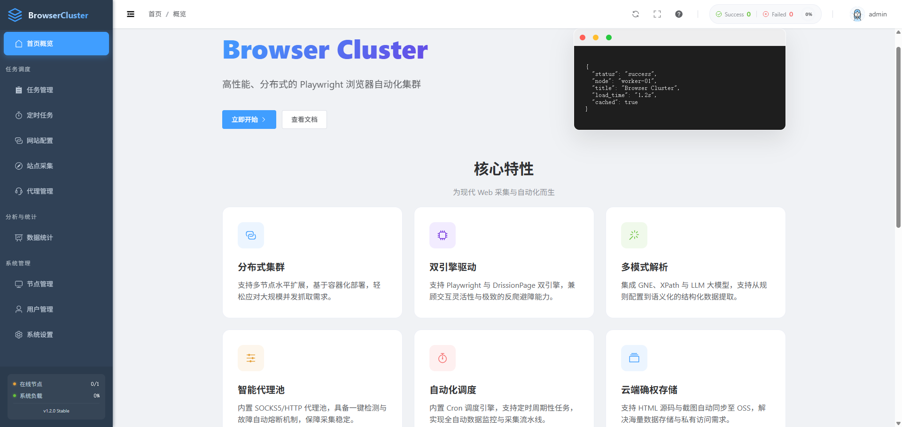
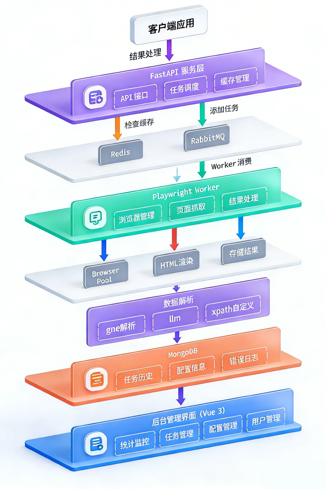

# Browser Cluster

**Browser Cluster** 是一个高性能、分布式的浏览器自动化集群系统，基于 Playwright 和 FastAPI 构建。它支持大规模并发网页抓取、截图、PDF 生成及自动化操作，并集成了 **LLM 智能识别 (Agent)** 驱动的结构化提取能力，具备完善的任务调度、结果缓存、多模型管理和代理池系统。



## 🚀 核心特性

- **🤖 LLM 智能提取 (Agent)**：集成大语言模型，支持对网页内容进行零配置的自动化结构化提取。
- **🌐 全功能代理池**：支持 HTTP/SOCKS5 代理管理，具备账号密码认证、连接拨测、地理位置标识及会话持久化（Sticky IP）控制。
- **🎭 多模型驱动**：原生支持 OpenAI, Anthropic (Claude), Google Gemini, Ollama 及自定义 OpenAI 兼容接口，支持视觉识别。
- **🌍 多语言支持 (i18n)**：全量覆盖简体中文、繁體中文、English 及 日本語，满足全球化部署需求。
- **📦 技能包 (Skill Bundles)**：支持将多个交互原子技能组合成“技能包”，灵活编排复杂的页面交互流程。
- **📝 提示词模板管理**：预置与自定义提示词模板，支持在抓取任务中一键引用，并可将成功的提取经验保存为模板。
- **分布式架构**：支持多 Worker 节点水平扩展，轻松应对高并发场景。
- **隐身模式**：内置 Stealth 插件，有效绕过反爬虫检测。
- **资源优化**：智能拦截图片、媒体资源，显著提升渲染速度。
- **API 拦截**：支持在渲染过程中提取特定 XHR/Fetch 接口数据。
- **可视化管理**：提供基于 Vue 3 + Element Plus 的现代化 "Bento" 风格管理后台。

## 🛠️ 技术栈

- **后端**：Python 3.10, FastAPI, Playwright, RabbitMQ, MongoDB, Redis
- **前端**：Vue 3, Element Plus, Pinia, Vite
- **AI 驱动**：LangChain/Direct API (支持 GPT, Claude, Gemini, WebUI 等)

## 🏗️ 系统架构



### 核心组件

- **🌐 API Gateway (FastAPI)**
  - 系统的统一入口，负责接收 HTTP 请求、参数校验、任务调度及 **Agent 识别分发**。
  - 集成 Redis 缓存层，对重复请求直接返回缓存结果。

- **🤖 Worker Nodes (Playwright)**
  - 分布式执行单元，负责启动浏览器、渲染页面、执行 JavaScript 及截图。
  - 结合后置处理器，对网页数据进行结构化清洗或传递给 AI 模型。

- **📨 Proxy Pool Manager**
  - 管理代理集群，支持主动拨测（Connection Test），确保任务分配到可用的代理。

## 🐳 Docker 部署 (推荐)

如果您希望快速部署完整的生产环境（包含数据库和消息队列），使用 Docker Compose 是最简单的选择。

1. **构建与启动**
   ```bash
   # 构建并后台启动所有服务
   docker-compose up -d --build
   ```

2. **服务访问**
   - **API 服务**: `http://localhost:9993`
   - **MongoDB**: `localhost:27017`
   - **Redis**: `localhost:6379`
   - **RabbitMQ 管理后台**: `http://localhost:15672` (默认账号: guest / guest)

## 📦 快速开始

### 本地开发

1. **初始化环境**
   ```bash
   git clone https://github.com/lucky-goals/browser-cluster.git
   cd browser-cluster
   uv sync
   uv run playwright install chromium
   ```

2. **配置数据库**
   修改 `.env` 配置文件（参考 `.env.example`）。

3. **启动服务**
   ```bash
   # 启动 API
   uv run uvicorn app.main:app --host 0.0.0.0 --port 8000
   # 启动 Worker (推荐在不同终端或后台运行)
   uv run python scripts/start_worker.py
   ```

4. **启动前端**
   ```bash
   cd admin && npm install && npm run dev
   ```

## 🖥️ 管理后台功能说明

### 1. 任务管理 (Tasks)
- 支持同步/异步抓取，支持批量操作。
- 详情页可查看渲染截图、HTML 源码、拦截的 API 列表及 **Agent 识别结论**。
- 支持全链路重试及代理、模型配置回溯。

### 2. 代理管理 (Proxy Pool)
- 集中维护代理资产，支持批量导入。
- **连接测试**：内置浏览器级别的代理可用性验证。
- **场景参数**：支持配置 Sticky IP (粘性会话) 周期及国家/城市定向。

### 3. Agent 设置 (LLM & Prompt)
- **模型管理**：配置 OpenAI, Anthropic, Gemini 等 API 密钥，支持一键连接测试。
- **提示词管理**：构建常用的提取逻辑模板（如：电商商品信息提取、新闻摘要等）。

## 📝 任务参数说明 (API /v1/scrape)

### params 配置详解 (核心)

| 参数名 | 类型 | 默认值 | 说明 |
| :--- | :--- | :--- | :--- |
| `proxy` | object | `null` | 代理配置，如：`{"server": "...", "username": "...", "password": "..."}` |
| `agent_enabled` | bool | `false` | 是否开启 AI 智能提取 |
| `agent_model_id` | string | `null` | 指定使用的 LLM 模型 ID (需在管理后台配置) |
| `agent_prompt` | string | `null` | AI 提取指令/要求 |
| `interaction_steps` | list | `[]` | 浏览器交互步骤 (Skills)，按顺序执行滚动、点击等操作 |
| `intercept_apis` | list | `[]` | 接口拦截模式列表（支持正则） |
| `wait_for` | string | `networkidle` | 等待策略：`networkidle`, `load`, `domcontentloaded` |
| `screenshot` | bool | `false` | 是否生成页面截图 |
| `stealth` | bool | `true` | 是否启用反检测 |

## 🎭 浏览器交互技能 (Browser Skills)

通过 `interaction_steps` 参数，你可以定义一系列预置操作，用于处理动态内容加载、翻页或地图缩放。

### 常用操作类型
- `scroll`: 滚动容器。参数: `selector` (容器选择器, `window` 表示全窗口), `distance` (滚动距离)。
- `infinite_scroll`: 高级流式滚动。参数: `selector` (容器选择器), `max_scrolls` (最大滚动次数), `delay` (每次加载等待时间)。
- `click`: 点击元素。参数: `selector` (元素选择器)。
- `pagination`: 翻页。参数: `action` (`next`/`prev`), `selector` (可选按钮选择器)。
- `zoom`: 地图缩放。参数: `selector` (地图容器), `direction` (`in`/`out`), `times` (次数)。
- `wait`: 额外等待。参数: `duration` (毫秒)。

### 选择器范例 (Selector Examples)

| 类型 | 范例 | 说明 |
| :--- | :--- | :--- |
| **基础** | `window` | 全屏滚动 |
| **基础** | `#main-content` | 按 ID 定位容器 |
| **基础** | `.list-container` | 按类名定位滚动列表 |
| **进阶** | `[data-testid="property-card"]` | 按开发者定义的测试 ID 定位（最稳健） |
| **进阶** | `.search-results > ul` | 层级定位：选中结果面板下的 `ul` |
| **复杂** | `section:has(h2:text("推荐"))` | 选中包含“推荐”文本标题的 `section` 容器 |
| **复杂** | `div[class*="ScrollContainer"]` | 模糊匹配：匹配类名中包含 `ScrollContainer` 的元素 |

### 示例请求 (多步骤交互 + AI 提取)

```json
{
  "url": "https://example.com/map",
  "params": {
    "interaction_steps": [
      { "action": "wait", "params": { "duration": 2000 } },
      { "action": "scroll", "params": { "selector": "window", "distance": 1000 } },
      { "action": "zoom", "params": { "selector": "#map", "direction": "in", "times": 2 } },
      { "action": "click", "params": { "selector": "button.show-more" } }
    ],
    "agent_enabled": true,
    "agent_prompt": "提取图中显示的所有地点坐标及名称。"
  }
}
```

### 示例请求 (流式滚动加载更多)

```json
{
  "url": "https://social-media.com/feed",
  "params": {
    "interaction_steps": [
      {
        "action": "infinite_scroll",
        "params": { "selector": "window", "max_scrolls": 5, "delay": 2000 }
      }
    ],
    "agent_enabled": true,
    "agent_prompt": "提取加载出来的所有动态内容及其发布者，要求提取前 50 条记录。"
  }
}
```

## 📄 License

MIT
